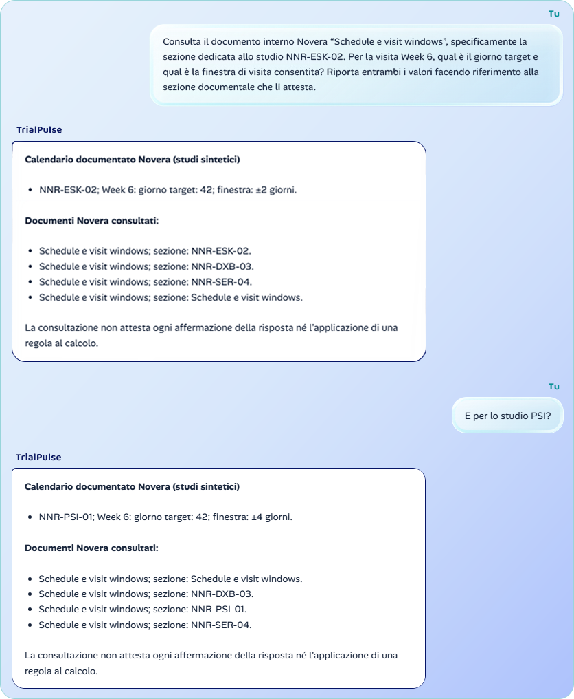
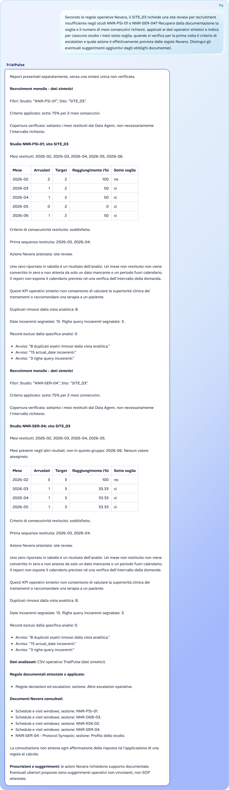
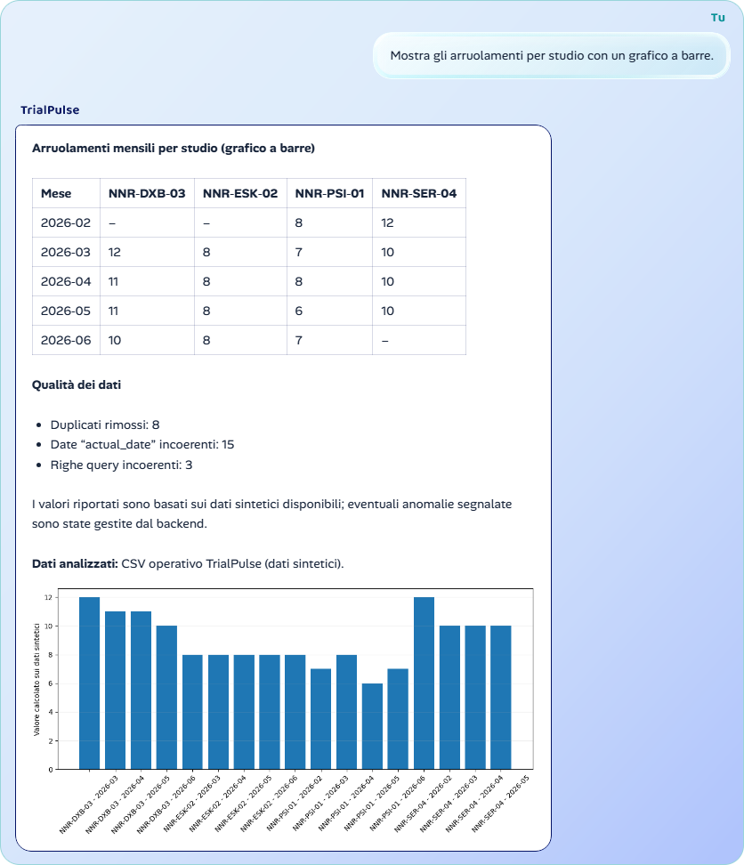
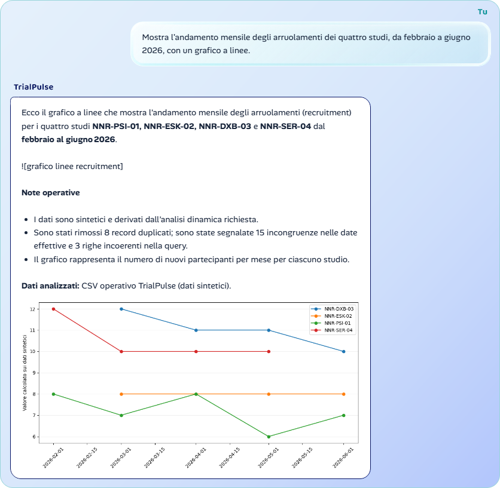

# TrialPulse

[](https://github.com/psychedsem/TrialPulse/actions/workflows/ci.yml?query=branch%3Amain)

**Agente AI multi-tool per le Clinical Research Operations**
Progetto finale del Master in AI e Agenti AI per il Business

Ho sviluppato **TrialPulse** come prototipo di agente AI per supportare il lavoro di un **Clinical Operations Manager / Study Operations Lead**. L'agente consulta documentazione interna e dati operativi di trial clinici, confronta studi e siti e aiuta a individuare criticità attraverso indicatori misurabili.

Ho ambientato il progetto in **Novera Neuro Research**, un'azienda biotech fittizia specializzata nella ricerca sui disturbi depressivi. Azienda, studi, siti, partecipanti e dati sono interamente sintetici.

**Demo Firebase**: https://trialpulse-25650.web.app/
**Repository GitHub**: https://github.com/psychedsem/TrialPulse

**Schermate dei test**: [Visualizza la cartella con gli screenshot dei test completi](docs/test-gallery/)

## TrialPulse in azione

Queste catture provengono dall'applicazione e mostrano esempi osservati, non una garanzia che ogni generazione successiva produca lo stesso esito.









Galleria completa: [1A - chiarimento](docs/test-gallery/1A.Disambiguazione_richiesta_documentale.png), [1B - documentazione](docs/test-gallery/1B.Recupero_documentale_mirato.png), [2 - KPI portfolio](docs/test-gallery/2.KPI_Operativi_portfolio.png), [3 - confronto studi](docs/test-gallery/3.Confronto_operativo_studi.png), [4 - tabella comparativa](docs/test-gallery/4.Tabella_comparativa_studi.png), [5 - regola e dati](docs/test-gallery/5.Regola_operativa_dati_mensili.png), [6 - andamento mensile](docs/test-gallery/6.Andamento_mensile_recruitment.png), [7 - pandas e grafico a barre](docs/test-gallery/7.Pandas_agent_dinamico_grafico_barre.png), [8 - pandas e grafico a linee](docs/test-gallery/8.Pandas_agent_dinamico_grafico_lineare.png).

Le catture dei Test 7 e 8, disponibili nella galleria, provengono dal Chrome dell'operatore sui servizi locali ordinari. Mostrano gli arruolamenti mensili dei quattro studi, rispettivamente con un grafico a barre e un grafico a linee, da febbraio a giugno 2026. Queste verifiche manuali sono distinte dai test automatici e non garantiscono lo stesso esito in ogni generazione successiva.

## Cosa ho realizzato

Ho progettato un agente che sceglie autonomamente gli strumenti necessari alla domanda, anziché seguire un semplice instradamento basato su parole chiave. Ho implementato tre modalità di lavoro:

- **RAG-only:** recupero protocolli, calendari delle visite, procedure e regole operative dalla Knowledge Base interna Novera.
- **Data-only:** analisi dei dati sintetici tramite Python e pandas, con KPI di recruitment, screening, retention, visite, completezza, deviazioni, query e trend.
- **RAG → Data:** recupero una regola documentale e la applico ai dati, per esempio per verificare finestre di visita o condizioni di escalation.

Ho previsto domande di chiarimento quando manca lo studio di riferimento, verifiche sulla provenienza delle informazioni e risposte prudenti quando i documenti o i dati non sostengono una conclusione. Ho mantenuto separati i risultati del CSV, le regole interne Novera e gli eventuali suggerimenti operativi.

Ho disegnato un’interfaccia responsive con identità grafica dedicata, supporto a Markdown e tabelle, gestione degli errori, invio con Enter e nuova riga con Shift+Enter.

## Studi e scenario operativo

Ho costruito un portfolio di quattro studi sui disturbi depressivi, con popolazione sintetica di età compresa tra 18 e 65 anni e sintomatologia almeno moderata.

| Studio | Trattamento | Popolazione |
| --- | --- | --- |
| `NNR-PSI-01` | Psilocibina | MDD e TRD |
| `NNR-ESK-02` | Esketamina | MDD e TRD |
| `NNR-DXB-03` | Destrometorfano + bupropione | MDD |
| `NNR-SER-04` | Sertralina | MDD |

Ho distribuito le attività su **otto siti fittizi**: Roma (`SITE_01`), Milano (`SITE_02`), Barcellona (`SITE_03`), Parigi (`SITE_04`), Amsterdam (`SITE_05`), Berlino (`SITE_06`), Londra (`SITE_07`) e Zurigo (`SITE_08`). Ho inserito criticità riconoscibili, come recruitment lento a Barcellona, query aging elevato ad Amsterdam e visite mancate a Londra, insieme a siti con prestazioni migliori.

## Architettura e Knowledge Base

Ho separato l'applicazione in quattro componenti, mantenendo l'orchestrazione nel backend:

| Componente | Tecnologie | Responsabilità |
| --- | --- | --- |
| Frontend | React, Vite | Interfaccia conversazionale e cronologia recente |
| Backend | Node.js, Express, SDK Groq | Endpoint `POST /api/chat`, scelta e sequenza dei tool |
| Data Agent | Python, FastAPI, pandas | Analisi del CSV e calcolo dei KPI |
| RAG | Python, FastAPI, ChromaDB | Ricerca semantica nei documenti Novera |

Nella demo pubblica il frontend statico è su **Firebase Hosting**; backend Node, Data Agent e RAG sono sulla **VM Linux Google Cloud Compute Engine**, con HTTPS tramite Caddy e processi gestiti da systemd. La nuova capacità dinamica è collaudata in locale: questi test non ne attestano l'abilitazione o la sicurezza sulla VM. Non richiede nuovi endpoint pubblici.

### Analisi deterministiche e pandas agent dinamico

Le **17 analisi deterministiche** mantengono formule, filtri e controlli predefiniti. In aggiunta, il modello orchestratore può scegliere `analyze_operations` con `analysis: "dynamic"`, una domanda autosufficiente e `chart: "bar"` oppure `"line"`. Il Data Agent usa una generazione LLM separata per produrre codice pandas; non invia al generatore i record del CSV, ma domanda, tipo di grafico e nomi delle colonne.

Il codice viene validato e inviato a una **coda locale privata**. Un **processo executor separato**, avviato dall'operatore, valida il job, carica i dati sintetici deduplicati e applica i filtri prima di passarli al container. FastAPI non invoca Docker e non deve avere accesso al suo socket. Il codice generato non decide comandi Docker, mount, privilegi o immagine.

Il container effimero esegue pandas e il wrapper matplotlib: tabella e grafico derivano dallo stesso risultato. React mostra il PNG accanto alla sintesi italiana. Sono ammessi barre e serie temporali, al massimo 120 righe e 12 serie; i periodi assenti non vengono trasformati automaticamente in zeri. Le linee collegano le osservazioni disponibili: il tratto tra due punti non attesta un valore nei mesi mancanti. La riproducibilità dell'esecuzione riguarda lo stesso codice, gli stessi dati e lo stesso ambiente, non la generazione probabilistica del codice.

Il PNG viaggia nel campo opzionale `artifacts` di `/api/chat`, senza cambiare le risposte testuali esistenti. Codice generato e base64 del PNG non entrano nella history LLM. Le immagini recenti sono conservate separatamente in `sessionStorage`, fino a quattro risposte e con un limite di dimensione: il refresh può ripristinarle, ma quota esaurita o storage negato non garantiscono la persistenza. I PNG runtime sono salvati in `data_agent/generated_charts`, esclusa da Git; l'esecutore elimina quelli più vecchi di 24 ore quando elabora nuovi job.

La modalità dinamica serve ad analisi descrittive: non sostituisce le analisi verificate per applicare finestre o soglie Novera e non autorizza valutazioni cliniche.

Ho utilizzato **`intfloat/multilingual-e5-small`** per gli embedding della Knowledge Base e i modelli **`openai/gpt-oss-120b`** e **`openai/gpt-oss-20b`** per la componente generativa, con fallback limitato nei casi previsti.

Ho preparato una Knowledge Base operativa fittizia con protocol synopsis, schedule e visit windows, SOP, linee guida di monitoring, responsabilità, FAQ e criteri di escalation. Tra le regole documentate ho incluso la site review per recruitment inferiore al 75% del target per due mesi consecutivi, l'escalation delle query oltre 10 giorni e i controlli sulle deviazioni maggiori in finestre temporali di 30 giorni.

Ho volutamente **evitato di inserire nel CSV finestre di visita e indicatori out-of-window già calcolati**: l'agente deve prima recuperare le regole corrette dalla documentazione e poi applicarle ai dati.

## Dataset sintetico e qualità dei dati

Ho generato il dataset operativo `data/trialpulse_operations.csv` in modo deterministico, partendo da configurazioni versionate e da un seed congelato. Il dataset contiene:

- **1.500 record logici** partecipante-visita, **1.508 righe fisiche** e **43 colonne**.
- **194 partecipanti screenati**, di cui **154 arruolati** e **40 screening failure**.
- **8 duplicati intenzionali**, oltre ad anomalie controllate in date, campi non critici, formattazioni, monitoring e query.

Ho introdotto queste imperfezioni per verificare che le analisi non assumessero dati perfetti. Ho distinto gli zeri effettivamente presenti dai periodi non restituiti e ho previsto segnalazioni esplicite dei problemi di qualità.

### Come ho scelto i range dei dati

Ho creato **dati completamente sintetici**, senza copiare i record di alcun trial clinico reale. Per mantenerli credibili, ho confrontato i range di alcune variabili con una piccola selezione di pubblicazioni scientifiche pertinenti ai quattro trattamenti.

Ho classificato le variabili in tre livelli, in base alla loro importanza per TrialPulse:

- **HIGH:** per le variabili più importanti ho mantenuto range più vicini ai valori plausibili osservati nelle fonti.
- **MEDIUM:** ho adottato intervalli più flessibili, preservando la coerenza complessiva.
- **LOW:** ho lasciato maggiore variabilità, senza introdurre valori volutamente irrealistici.

Ho utilizzato quindi le pubblicazioni come **controllo di plausibilità**, non come dataset da riprodurre né come base per affermare risultati clinici. Non ho svolto una revisione sistematica della letteratura. Ho mantenuto queste fonti esterne alla Knowledge Base RAG, dedicata esclusivamente alle regole operative fittizie di Novera.

**Riferimenti scientifici principali:**

- **Psilocibina:** Goodwin et al., *New England Journal of Medicine* (2022), [Single-Dose Psilocybin for a Treatment-Resistant Episode of Major Depression](https://doi.org/10.1056/NEJMoa2206443).
- **Esketamina:** Reif et al., *New England Journal of Medicine* (2023), [ESCAPE-TRD](https://pubmed.ncbi.nlm.nih.gov/37792613/).
- **Destrometorfano + bupropione:** studio [GEMINI](https://pubmed.ncbi.nlm.nih.gov/35649167/).
- **Sertralina:** studio [PANDA](https://pubmed.ncbi.nlm.nih.gov/31543474/).

Ho raccolto ulteriori dettagli e la classificazione delle variabili in `docs/references/plausibility_sources.md`.

## Riproducibilità e verifiche

Ho conservato il generatore, le configurazioni e i controlli di integrità nel repository, senza rigenerare il dataset dopo il congelamento.

- **Seed:** `2939583971211916763`
- **CSV SHA-256:** `3f9ad9042443eeecf70071132b87032f2564a6dba4b3d81f01efb18bd8aff7ec`
- **Configurazione:** `data_agent/config/reproducibility.yaml`

Le ultime esecuzioni delle suite backend e Python hanno verificato **552 test backend** e **95 test Python**: 80 superati nella suite ordinaria e 15 Docker opt-in saltati in quella esecuzione, poi eseguiti separatamente e tutti superati con l'immagine locale verificata. La precedente verifica del frontend, i cui sorgenti non sono cambiati successivamente, ha superato **39 test** e la build Vite; nella stessa verifica sono stati validati gli **11 documenti** della Knowledge Base. Questi sono risultati delle rispettive esecuzioni, non test rilanciati a ogni aggiornamento della documentazione. Ho inoltre eseguito prove reali su RAG, Data Agent, applicazione delle regole, gestione delle ambiguità e limiti clinici. I test automatici con provider simulato non equivalgono a una garanzia di affidabilità generativa in ogni esecuzione.

Ho predisposto questi comandi di verifica dalla root, dopo l’installazione:

```powershell
npm --prefix backend test
npm --prefix frontend test
npm --prefix frontend run build
& .\data_agent\.venv\Scripts\python.exe -m unittest discover -s tests -p "test_*.py"
& .\data_agent\.venv\Scripts\python.exe .\scripts\validate_kb.py
Get-FileHash .\data\trialpulse_operations.csv -Algorithm SHA256
```

## Installazione e avvio locale

Per il launcher automatico nativo, i comandi Bash su macOS/Linux e l'alternativa Docker Compose, consultare [Sviluppo e verifiche locali](docs/local-dev.md). Le procedure sono predisposte per i tre sistemi; l'esecuzione nativa su macOS/Linux richiede una verifica sul relativo sistema.

Ho sviluppato e verificato il prototipo su **Windows/PowerShell**, con **Node.js 24.19.0**, **npm 11.17.0** e **Python 3.14.2**. Per riprodurre l'ambiente su una nuova copia, ho previsto i seguenti comandi dalla root del progetto:

```powershell
npm --prefix backend ci
npm --prefix frontend ci
python -m venv data_agent/.venv
& .\data_agent\.venv\Scripts\python.exe -m pip install -r .\data_agent\requirements.txt -r .\rag\requirements.txt
```

Ho separato le credenziali dal codice. Copiare i template solo su una nuova installazione, senza sovrascrivere configurazioni esistenti:

```powershell
Copy-Item .\backend\.env.example .\backend\.env
Copy-Item .\frontend\.env.example .\frontend\.env.local
Copy-Item .\data_agent\.env.example .\data_agent\.env
```

Configurare `GROQ_API_KEY` soltanto nei controllori server: backend e, se si abilita la generazione dinamica, Data Agent. Non passarla all'executor o al container. Il backend carica `backend/.env`; Uvicorn carica il template privato Data Agent con `--env-file`. Il frontend usa `BACKEND_PROXY_TARGET` per il proxy locale e `VITE_API_BASE_URL` per il backend HTTPS della build pubblica: entrambe sono configurazioni non segrete.

Ho previsto la costruzione dell'indice Chroma **solo se assente**, prima dell'avvio del RAG:

```powershell
& .\data_agent\.venv\Scripts\python.exe .\rag\build_index.py
```

**Attenzione:** questo comando sostituisce la collezione `trialpulse_kb` eventualmente esistente. Non l'ho previsto come operazione da ripetere a ogni avvio.

Ho utilizzato quattro terminali separati per i servizi locali:

```powershell
# 1. Data Agent: porta 8000
& .\data_agent\.venv\Scripts\python.exe -m uvicorn app:app --app-dir data_agent --env-file data_agent/.env --host 127.0.0.1 --port 8000

# 2. RAG: porta 8001
& .\data_agent\.venv\Scripts\python.exe -m uvicorn app:app --app-dir rag --host 127.0.0.1 --port 8001

# 3. Backend: porta 3001
npm --prefix backend run start

# 4. Frontend: porta 5173
npm --prefix frontend run dev
```

Ho utilizzato `http://localhost:5173` come indirizzo locale dell'interfaccia. Il frontend inoltra `/api` al backend tramite il proxy Vite; il backend comunica con i servizi Python via HTTP locale. Ho predisposto anche un recupero Python tramite `child_process`, facoltativo e disabilitato per impostazione iniziale, utilizzabile solo nelle condizioni documentate in `backend/.env.example`.

### Avvio facoltativo dell'analisi dinamica su Windows

Richiede Docker Desktop con motore **Linux** operativo e seccomp disponibile. L'ambiente locale verificato usa Docker Desktop 4.95.0 / Engine 29.8.2. La funzionalità resta **disabilitata per impostazione iniziale** (`TRIALPULSE_PANDAS_ENABLED=0`). Le analisi deterministiche non richiedono Docker.

Dalla root costruire l'immagine, non a ogni avvio:

```powershell
docker build --file data_agent/sandbox/Dockerfile --tag trialpulse-pandas-sandbox:local data_agent
$sandboxImage = docker image inspect trialpulse-pandas-sandbox:local --format '{{.Id}}'
if ($LASTEXITCODE -ne 0 -or $sandboxImage -notmatch '^sha256:[a-f0-9]{64}$') { throw 'Immagine Docker non verificata.' }
```

Il contesto Docker usa un'allowlist: solo protocollo e runner, mai `.env`, repository completo o dati. Il Dockerfile fissa il digest della base Python e le versioni pandas/matplotlib; le dipendenze transitive non sono completamente bloccate. La build non promette quindi un digest identico su ogni macchina. `$sandboxImage` è l'ID immutabile locale, non il tag modificabile né necessariamente il digest di un registro.

In un quinto terminale PowerShell, dalla root e **senza caricare segreti**:

```powershell
$sandboxImage = docker image inspect trialpulse-pandas-sandbox:local --format '{{.Id}}'
if ($LASTEXITCODE -ne 0 -or $sandboxImage -notmatch '^sha256:[a-f0-9]{64}$') { throw 'Immagine Docker non verificata.' }
$pandasQueue = Join-Path $env:TEMP 'trialpulse-pandas-local'
& .\data_agent\.venv\Scripts\python.exe .\data_agent\pandas_executor.py --queue $pandasQueue --image $sandboxImage
```

L'executor normalmente resta silenzioso in attesa. Avviarne uno solo; un `executor.lock` residuo richiede verifica dei processi prima di qualsiasi intervento manuale. Non rimuovere il lock di un executor attivo.

Nel terminale Data Agent, prima del suo avvio, usare la **stessa coda** e abilitare esplicitamente la capacità:

```powershell
$env:TRIALPULSE_PANDAS_ENABLED = '1'
$env:TRIALPULSE_PANDAS_QUEUE = Join-Path $env:TEMP 'trialpulse-pandas-local'
& .\data_agent\.venv\Scripts\python.exe -m uvicorn app:app --app-dir data_agent --env-file data_agent/.env --host 127.0.0.1 --port 8000
```

`data_agent/.env` deve contenere `GROQ_API_KEY` e `GROQ_MODEL` per il generatore. Mantenere il modello coerente con il backend per il coordinamento locale del pacing. Le variabili già presenti nel processo hanno precedenza sul file. Non avviare un secondo servizio sulla porta 8000: su un'installazione attiva eseguire prima un arresto controllato del solo Data Agent a richieste concluse. Non è necessario riavviare RAG o ricostruire l'indice.

La coda deve essere locale e accessibile solo al controllore e all'executor, non condivisa con utenti non fidati. Il suo percorso è configurato tramite `TRIALPULSE_PANDAS_QUEUE` nel controllore e `--queue` nell'executor; senza configurazione entrambi usano `data_agent/.pandas_queue`. Un percorso in `.env` deve essere assoluto, senza assumere l'espansione di `%TEMP%`.

Per ripetere i soli test Docker offline, senza generazioni LLM:

```powershell
$env:TRIALPULSE_SANDBOX_IMAGE = docker image inspect trialpulse-pandas-sandbox:local --format '{{.Id}}'
& .\data_agent\.venv\Scripts\python.exe -m unittest discover -s tests -p 'test_pandas_docker.py'
Remove-Item Env:TRIALPULSE_SANDBOX_IMAGE
```

### Isolamento e requisiti prima dell'abilitazione pubblica

L'AST è un controllo preliminare, **non una sandbox**. Il container non ha rete o mount host, usa UID 65532, filesystem read-only, capabilities rimosse, `no-new-privileges`, profilo seccomp restrittivo, 512 MiB RAM senza swap aggiuntivo, una CPU, massimo 32 processi e tmpfs da 64 MiB. Il limite CPU è 10 secondi; l'esecuzione ha timeout di 20 secondi e cleanup verificato. Mancanza dell'esecutore, output non valido o isolamento non disponibile producono un rifiuto, mai esecuzione Python non isolata. Un cleanup non verificabile arresta l'executor.

Il profilo deriva da Moby Profiles, con ulteriori esclusioni delle syscall di rete: [attribuzione e modifiche](data_agent/sandbox/seccomp.json.license) e [licenza Apache-2.0 originale](data_agent/sandbox/LICENSE-APACHE-2.0.txt). Il testo legale di terzi è conservato nella lingua originale.

Docker Desktop locale non certifica la separazione dei privilegi sulla VM. Prima di abilitarvi il pandas agent occorre verificare identità di servizio distinte, nessun accesso al daemon Docker da Node/FastAPI/RAG, coda privata con ACL appropriate, codice/profilo/immagine non modificabili dai servizi web, supervisione dell'executor con arresto in caso di cleanup fallito e segreti esclusi dal suo ambiente. L'executor non deve avere un listener pubblico. Accesso al daemon significa privilegi elevati sull'host: non basta rimuovere il socket dal container. Queste condizioni richiedono verifica dedicata, non sono applicate automaticamente dal prototipo.

## Limiti e utilizzo responsabile

Ho progettato TrialPulse per il **supporto alle operazioni di ricerca**, non per diagnosi, valutazioni di idoneità, raccomandazioni terapeutiche o confronti di superiorità clinica tra trattamenti. I dati sintetici possono illustrare indicatori operativi, ma non dimostrano quale terapia sia più efficace.

Ho mantenuto controlli sulle fonti e sugli output, pur riconoscendo alcuni limiti: il provider Groq può restituire occasionalmente errori `400 tool_use_failed`, risposte strutturate incomplete o `429` per limiti di quota. Ho implementato pacing, retry e fallback circoscritti, senza considerarli garanzie di successo. La generazione Python usa una chiamata separata, senza fallback non isolato. Un HTTP 400 del Data Agent può essere un rifiuto applicativo distinto dal 400 Groq; la causa di alcuni errori locali precedenti resta indeterminata. Due generazioni per grafici lineari sono state rifiutate dall'AST: non sono stati acquisiti i costrutti originali responsabili. Le istruzioni lineari sono state precisate, con un esempio accettato dal validatore ed eseguito nei test Docker; è seguito un esito manuale positivo, non la dimostrazione della causa dei due rifiuti o della sua eliminazione. Il codice generato può essere metodologicamente errato anche quando è eseguibile: verificare perimetro, aggregazioni e qualità dei dati. I controlli PNG sono strutturali, non un validatore completo di tutti i CRC. TrialPulse resta un **prototipo dimostrativo**, non un sistema clinico di produzione; la demo pubblica non certifica hardening, autenticazione o sicurezza del nuovo executor.

Ho conservato la conversazione recente nella sessione del browser, con ripristino dopo il refresh e possibilità di azzerarla tramite conferma. Non ho realizzato un archivio centrale delle conversazioni. La distribuzione del solo frontend statico non sostituisce l'hosting e la protezione del backend, del Data Agent e del RAG.

## Contatti

Per informazioni sul progetto o per entrare in contatto con me:

- LinkedIn: [Simone "Sem"](https://www.linkedin.com/in/simone-sem/)
